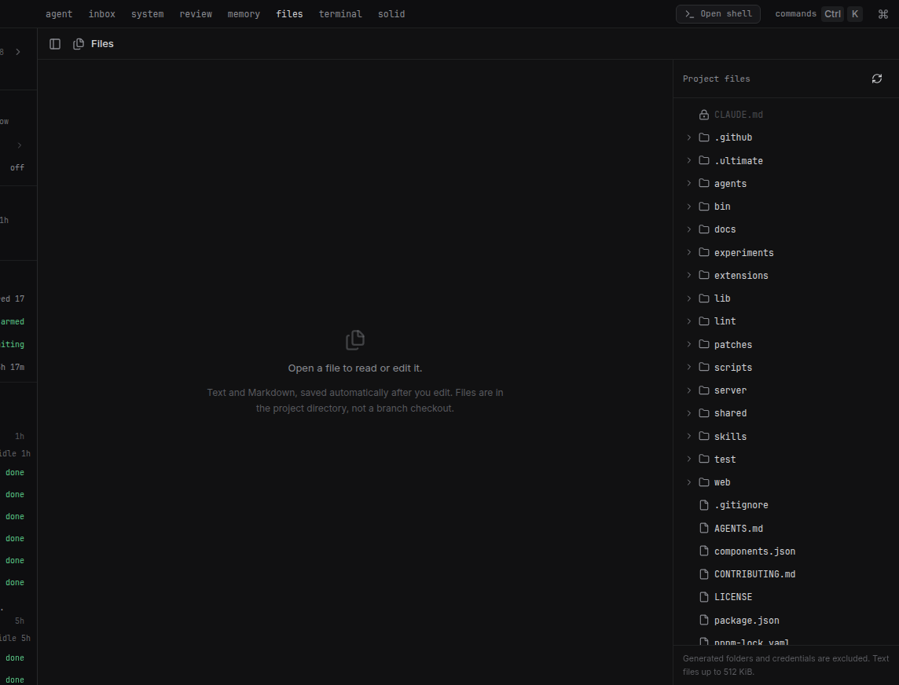

Browse and edit the project's text files with autosave, a Markdown preview and a plain source editor.

Files sits after Memory in the top navigation, with the editor in the centre and a file tree on the right. It reads the
host's `projectRoot`, never a branch checkout: it is for looking at and editing the project you are working on, not for
browsing the machine.



## What it does

- Tabs, and a file tree on the right (on a phone a toggle between tree and editor).
- Markdown opens as a rich preview you can edit in place, with Source next to it. The plain Source editor has no syntax
  highlighting.
- Autosave 700 ms after typing pauses; `Ctrl/⌘S` flushes a pending edit; a failed write stops autosaving until you retry
  or reload.
- Reload and closing a modified tab ask before discarding a draft.
- Images are inert placeholders, links do not navigate while editing, and file content is never executed.
- An edit the rich-text editor cannot represent (a literal newline inside inline code, for example) is refused with a
  visible Source hint rather than saved with a changed meaning.

## Limits

- There is no file creation, deletion, rename or agent tool: it edits what exists.
- Rich editing normalizes Markdown body formatting; frontmatter and a BOM are preserved separately.
- A document that cannot be safely rich-edited gets a read-only preview, and Source remains its editor.

## Install

```sh
mkdir -p "$HOME/.ultimate/extensions"
cp -r extensions/files "$HOME/.ultimate/extensions/"
cd "$HOME/.ultimate/extensions/files"
pnpm install --frozen-lockfile
```

If you link the extension instead of copying it, run the same install command in the linked Files folder. Files owns
its editor and preview dependencies; nothing needs to be installed in Ultimate's checkout.

## Ultimate 0.1 · Solid facet

The Files UI is a native Solid 2 facet (`web.solid.tsx`); Ultimate 0.1 no longer loads React `web.tsx`.
The **server read/save path, 700 ms debounce, conflict handling and sessionStorage draft key** have not changed.
The existing lossless Tiptap engine remains in `markdown-editor.ts`; its DOM lifecycle now belongs to Solid.
Unsupported Markdown is shown by an inert Solid read-only renderer, without image fetches, active links or HTML injection. Source remains the authoritative fallback for unsupported syntax.

After installing this version, keep any unsaved work from the previous running Ultimate tab until you confirm the new version restores it. Do not delete the browser's stored drafts to fix an extension-loading error.

Migration is not complete until the compiled Solid UI and autosave/recovery journeys are exercised on the installed Ultimate runtime.
