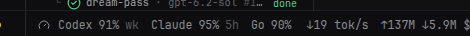

Provider subscription usage in the status line, with a panel for the per-provider breakdown.

The status line shows each provider's remaining quota the way the provider reports it — for example `Codex 91% wk`,
`Claude 95% 5h`, `Go 90%` — refreshed while Ultimate runs. The chip opens a panel with the same numbers per window.



## What it reads

It reads the usage the provider exposes for the credentials Ultimate already has, from Pi's shared auth in
`~/.pi/agent`. It adds no login of its own and sends nothing anywhere else; with no credentials for a provider, that
provider simply does not appear.

## Install

From the repository root, run:

```sh
bash scripts/install-subscription-usage.sh
```

The installer updates only the known extension source files and preserves local changes as timestamped backups. It disables the obsolete installed React `web.tsx` by renaming it, and **does not touch** `~/.ultimate/subscription-usage.sqlite`, browser state or credentials. A plain `git pull` or `cp -r` alone can leave stale files in `~/.ultimate/extensions/subscription-usage/`.

## Ultimate 0.1

The UI uses `web.solid.tsx` and the native Solid 2 SDK. It provides the same
bottom status-line chip and subscription-usage panel; server providers, local
cache and network requests are unchanged. Remove the obsolete installed
`web.tsx` when upgrading the extension, otherwise Ultimate 0.1 displays an
incompatible React facet error. No GitHub Actions are required.
