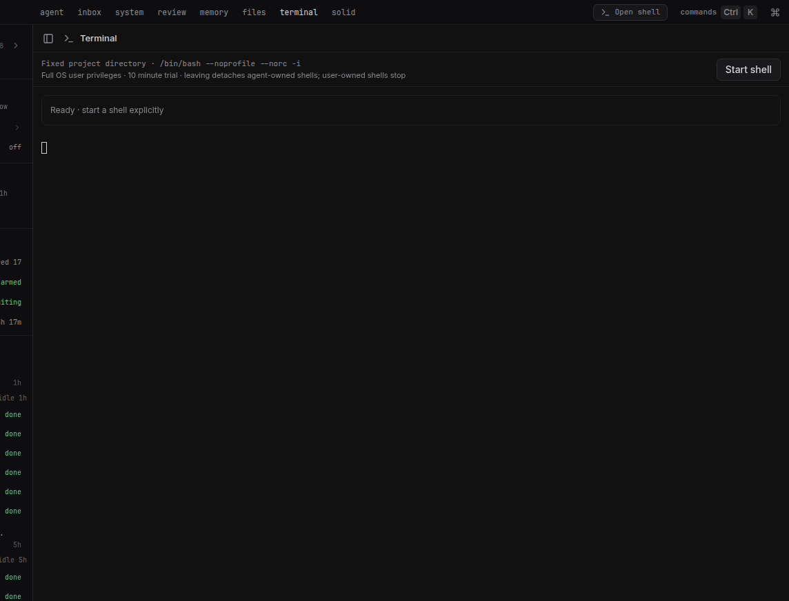

A bounded macOS and Linux terminal inside Ultimate: one real host PTY, automatically opened when you enter Terminal, with explicit Stop and a choice of installed login shells.

Entering the **Terminal** surface (including **Open shell** in the title bar) first checks for an existing PTY and reattaches it. If none is running and a valid shell is installed, it opens one automatically as a user-owned session. **Start shell** remains available after an explicit Stop or a failed start; agent-owned launches still require a separate approval.



## Choose a shell

The Shell menu discovers installed **Zsh**, **Bash** and **Fish**, using the OS account's login shell, `/etc/shells`, and standard system/Homebrew/Linuxbrew locations. Discovery does not spawn a command or change the OS configuration.

- **System default** resolves the OS account login shell (falling back to the verified `$SHELL`, then macOS Zsh or Linux Bash).
- Selecting an explicit executable such as `/bin/zsh` saves the default in Ultimate's durable **extension UI state** (`ext.terminal.default-shell`). This state survives reloads/restarts and is shared between Ultimate tabs through the host's supported state mechanism.
- A selection applies to **future** manual and agent-approved shells; it does not interrupt the running session. On every start, the server validates the selected path again against installed executable shells.
- Shells start with `-l -i`, so personal shell startup scripts can run. They have **full OS user privileges**, not sandbox restrictions. A user script may override the history settings.
- Changing the account's login shell with `chsh` does not change a terminal that was explicitly launched as Bash. This version removes the hardcoded Bash executable.
- The preference is untrusted UI state. Every new native PTY launch independently validates the requested executable on the server; no tokens, terminal output or session capability are stored in it.

## Solid UI implementation

This extension uses Ultimate's current **Solid 2** facet (`web.solid.tsx`) and its native SDK (`@/sdk/solid`). WTerm/Ghostty is mounted and destroyed directly through a Solid lifecycle, not through `@wterm/react`; native server PTY sessions and the read/grant/expiry protocol are unchanged. Components and DOM teardown are handled by Solid, and `npm ci` no longer installs React as a terminal-specific dependency.

## Find and share with the agent

- **Find** searches only WTerm's retained output, with next/previous and match-case controls. Press **⌘F** on macOS, **Ctrl+Shift+F** on Linux/Windows; ordinary **Ctrl+F** remains Bash's readline shortcut. Closing Find restores focus to the shell. On compact viewports the popover stays inside the screen.
- **To agent** shares only a manually selected range, after an editable preview and explicit confirmation. The destination conversation is **frozen when the preview opens**: switching conversations blocks the send rather than silently redirecting potentially private logs. Maximum **12 KiB UTF-8** selected text, **24 KiB** once encoded. Control characters and fake boundary markers are represented as one quoted JSON data value, not executable instructions; this framing **cannot guarantee** immunity to prompt injection.
- No selection is captured or uploaded automatically. **To agent never grants shell access**. **Allow shell control** is a separate, high-privilege server-authorized command granting the agent read/write access to the real OS shell for up to five minutes. Removing/renewing access and sharing text must not be confused.
- If message delivery is not confirmed due to a network failure, **check the destination conversation before sending again**: a failed response does not prove rejection, and the preview disables blind resubmission. The client does not log or persist this selection; the confirmed message becomes part of the chosen agent conversation.
- The existing WTerm selection supports ordinary browser **Copy**; no second terminal renderer or xterm.js addon is installed.
- See [Terminal Experience research](../../docs/terminal-experience-research-2026-11-22.md) for ready-made open-source patterns and the next shell-integration/command-block slices.

## Bounds

- **The shell has full OS user privileges** and starts in the host's fixed project root. The project directory is not a
  sandbox: commands reach files and the network with your user's rights.
- One active PTY, ten minutes maximum lifetime. Manually started shells remain active when switching Ultimate
  surfaces; agent-owned shells retain their 30 second renewable lease. A pending launch approval lives 30 minutes
  and creates no process.
- A 32 byte random capability bound to the admission login and address. Browser actions are user-only; this is not a
  sandbox against arbitrary code.
- Output is byte-bounded: 32 KiB per response, a 256 KiB buffer with pause at 192 KiB and resume at 64 KiB, 8 KiB per
  input event, 1 MiB per session.
- Close and expiry clean up jobs attached to the PTY, including foreground jobs in a separate process group. This is
  not containment: jobs that detach from the session can outlive it. On macOS, the extension does not scan for jobs
  after a natural shell exit because the controlling terminal can be reused.
- On Agent → Terminal navigation, the new view inspects and reattaches to the same PTY, replaying up to 128 KiB
  of acknowledged output. Older output can be lost; this is byte replay, not an exact screen snapshot (full-screen
  programs may need to redraw). A browser page unload **detaches** the manually started shell and a reload inspects and reattaches it, provided the native core and the bounded session remain alive.
- No dedicated listener, websocket, session catalog or persisted terminal state. A server restart loses the session;
  a transport failure does not reattach or extend it.

## Install

Use the Ultimate host's Node version and architecture. On macOS, install the Xcode command-line tools and Python 3
first. On Linux, see [node-pty's build prerequisites](https://github.com/microsoft/node-pty/tree/v1.1.0#dependencies).
For an already installed Terminal, synchronize source without replacing native dependencies:

```sh
bash scripts/install-terminal.sh "${PWD}"
```

Run this from the project directory where Ultimate starts (or pass that directory as the argument) so an existing project-level extension cannot shadow the update. The installer backs up changed files, preserves `node_modules/node-pty`, and disables obsolete `web.tsx` rather than deleting it.

For a **first-time** installation only, install native dependencies from the lockfile in `~/.ultimate/extensions/terminal` using `npm ci`.

**macOS requires a source build after every `npm ci`.** The `node-pty` 1.1.0 prebuilt macOS arm64 package ships a
non-executable `spawn-helper`; installing it successfully does not mean a shell can start. Run this from the installed
Terminal directory before opening a shell (verified on Node 26 arm64):

```sh
(cd node_modules/node-pty && npm exec --yes --package=node-gyp@13.1.0 -- node-gyp rebuild)
```

Linux uses the normal `npm ci` path; the extra rebuild step is not needed. The two pinned Pi packages match the
current Ultimate host. The WASM asset is the custom ABI bundled with `@wterm/ghostty`, not an official Ghostty binary.
